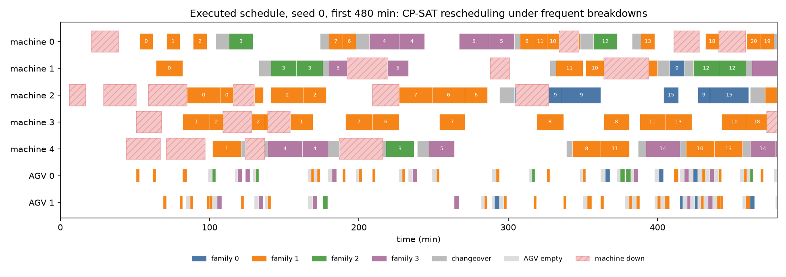

# Flexible job shop: simulated workshop, rescheduling on disturbances

A small, self-contained study of **dynamic scheduling of a flexible job shop**. A
discrete-event simulation plays the role of the real workshop: machines with alternative
routings and sequence-dependent changeovers, two AGVs that carry the jobs, random arrivals,
random breakdowns. A decision layer watches it and re-decides when something happens.
Three kinds of decision layer are compared on the same seeds:

1. **priority dispatching rules** (FIFO, SPT, EDD, and SST = shortest setup time);
2. **CP-SAT rescheduling on a rolling horizon** (OR-Tools): at every arrival, breakdown and
   repair, a constraint-programming model of the jobs in the shop is solved again and the
   new plan replaces the old one;
3. a **DQN dispatching agent** (PyTorch) that chooses, at each sequencing decision, which
   rule to apply.

Every executed schedule goes through an independent checker (`jobshop/checker.py`).

> Everything here is synthetic: the workshop, the processing and changeover times, the
> layout, the arrivals and the breakdowns are drawn from seeded random generators. No data
> from a real plant. It is a modelling and comparison exercise, not a production tool.

## Problem

| Element | Model |
| --- | --- |
| Machines | 5 machines, one station each, plus a load station where jobs enter |
| Products | 4 families, 4 operations each; an operation can run on 1 to 3 machines, with machine-dependent processing times (6 to 30 min) |
| Changeovers | Sequence-dependent setup time on each machine when the family changes (3 to 10 min, asymmetric); none within a family. The changeover starts once the machine is free and the job is at the machine |
| Transport | 2 AGVs, one job at a time; travel 2 to 3 min between stations (handling included). Requests are served first come first served by the nearest idle AGV, for every method |
| Arrivals | 60 jobs per run, Poisson arrivals (one job every 20.8 min on average, i.e. machines loaded at 60 % before changeovers), uniform family mix |
| Due dates | arrival + k x shortest total processing time, k uniform in [2, 4] |
| Breakdowns | Per machine: exponential time between failures, repair time uniform in [10, 30] min. The interrupted operation resumes after the repair. A controller is told when a machine fails and the mean repair time, not the actual one |
| Disturbance levels | **no breakdowns**; **frequent breakdowns** (mean time between failures 120 min per machine, about 14 % downtime) |
| Decisions | routing (which eligible machine), sequencing (which waiting job a free machine starts), rerouting of waiting jobs after an event |

Time is in integer minutes. For a given seed, the jobs and the breakdowns are drawn once
(`jobshop/scenario.py`) and are identical for every method.

### Simulation (`jobshop/shop.py`)

SimPy processes: one for the arrivals, one per machine for failures and repairs, one per
operation (changeover, then processing, suspended and resumed around a breakdown), one per AGV
mission (empty leg, loaded leg). The simulator takes no scheduling decision: it calls the
controller (`route`, `sequence`, `on_event`) and logs every machine work segment and every
AGV leg. Checker and indicators use that log only.

### Dispatching rules (`jobshop/rules.py`)

Routing, common to the rules and to the DQN agent: the eligible machine with the earliest
expected finish (travel, work already committed to the machine, expected end of a repair).
Sequencing: the rule. On a breakdown, the jobs waiting at the failed machine are routed again
and move if another machine now looks better.

### CP-SAT rescheduling (`jobshop/cpsat.py`)

At each event the controller takes a snapshot (position and next operation of each job,
remaining work and expected availability of each machine) and solves a model with the same
patterns as my [satellite pass planning](https://github.com/ElieRouphael/satellite-pass-planning) model:

* one start and one end per remaining operation, one **optional interval** per eligible
  machine, exactly one present;
* **NoOverlap** per machine, and a **circuit** over the operations of the machine whose arcs
  carry the **sequence-dependent changeover times**;
* precedence inside a job, with a transport lag that depends on the two machines chosen;
* jobs already on their way keep their destination; jobs waiting in a queue may be moved;
* objective: 10 x total tardiness + total completion time;
* warm start: greedy schedules and the previous plan re-timed on the new snapshot; the best one
  is passed as a complete solution hint;
* stop on a deterministic-time budget (not wall clock) with interleaved workers, so a run is
  reproducible.

Only the beginning of each plan is executed before the next event replaces it. Between two
events, each machine follows the order of the plan and waits for the next planned job if it
is not there yet.

What the model does **not** contain: the AGVs. A move is a fixed lag (travel time + 2 min,
the median wait for an AGV measured in simulation). The simulated shop moves real AGVs, so
the plan and the shop drift apart and the next replan absorbs the difference. Future
arrivals and future breakdowns are unknown to the model.

### DQN agent (`jobshop/dqn.py`)

* decision point: a machine is free and at least two jobs wait for it;
* action: FIFO, SPT, EDD or SST; the job selected by that rule starts;
* state (29 features): for the job each rule would pick, its processing time, changeover time,
  slack, remaining operations and waiting time; queue length and slack statistics; number of
  jobs in the shop, share of late jobs, machines down, pending transport requests;
* reward: minus the increase, since the previous decision, of the tardiness the shop is already
  committed to. The rewards of a run sum exactly to minus its total tardiness;
* Double DQN, replay buffer, soft target update, Huber loss; code structure taken from my
  [CartPole DQN tutorial](https://elierouphael.github.io/tutorials/dqn-cartpole/index.html).

## Results

Full tables: [`results/results.md`](results/results.md), generated by `scripts/evaluate.py`;
one line per run in [`results/runs.csv`](results/runs.csv). 20 test seeds, 60 jobs per run,
two disturbance levels, 7 methods; mean over the seeds with a 95 % bootstrap confidence
interval. All 480 runs passed the checker.

"Greedy replan" is an ablation: the same event-driven rescheduling loop as CP-SAT, but the
plan is the greedy warm start, without the solver.

**No breakdowns**

| method | makespan (min) | mean tardiness (min) | max tardiness (min) | utilisation (%) | setup time (min) | decision time per run (s) |
| --- | --- | --- | --- | --- | --- | --- |
| FIFO | 1351 [1298, 1406] | 15.5 [7.6, 26.7] | 93 [69, 120] | 60.2 [57.8, 62.6] | 1089 [1058, 1121] | 0.001 |
| SPT | 1348 [1296, 1401] | 10.0 [5.4, 16.3] | 106 [65, 167] | 60.3 [57.9, 62.7] | 1044 [1016, 1075] | 0.001 |
| EDD | 1352 [1298, 1408] | 7.0 [3.3, 12.4] | 58 [43, 74] | 60.1 [57.6, 62.5] | 1025 [996, 1061] | 0.001 |
| SST | 1339 [1281, 1398] | 9.4 [5.2, 15.2] | 97 [70, 128] | 60.7 [58.0, 63.7] | 918 [867, 964] | 0.001 |
| DQN | 1345 [1291, 1399] | 7.4 [4.0, 12.1] | 70 [50, 93] | 60.4 [57.9, 63.0] | 988 [940, 1036] | 0.017 |
| Greedy replan | 1356 [1300, 1413] | 3.1 [1.3, 5.3] | 42 [26, 58] | 60.0 [57.5, 62.6] | 633 [597, 669] | 0.028 (60 replans) |
| **CP-SAT** | 1341 [1285, 1399] | **1.3 [0.2, 2.9]** | **19 [8, 32]** | 60.4 [57.9, 63.0] | 635 [606, 668] | 97 (60 replans, 1.61 s each, 56 % proven optimal) |

**Frequent breakdowns** (per machine: mean time between failures 120 min, mean repair 20 min)

| method | makespan (min) | mean tardiness (min) | max tardiness (min) | utilisation (%) | setup time (min) | decision time per run (s) |
| --- | --- | --- | --- | --- | --- | --- |
| FIFO | 1430 [1388, 1473] | 60.8 [41.9, 82.2] | 216 [179, 259] | 56.9 [55.3, 58.5] | 1091 [1058, 1129] | 0.001 |
| SPT | 1434 [1390, 1479] | 45.4 [32.0, 60.8] | 235 [182, 292] | 56.6 [54.9, 58.3] | 1036 [1000, 1074] | 0.002 |
| EDD | 1433 [1390, 1478] | 37.6 [27.1, 50.0] | 155 [133, 178] | 56.7 [54.9, 58.4] | 1014 [979, 1050] | 0.002 |
| SST | 1396 [1344, 1448] | 34.1 [24.8, 44.9] | 212 [171, 260] | 58.3 [56.2, 60.6] | 820 [762, 874] | 0.001 |
| DQN | 1412 [1361, 1465] | 35.4 [25.1, 47.0] | 183 [146, 225] | 57.8 [55.7, 60.0] | 904 [850, 957] | 0.020 |
| Greedy replan | 1416 [1371, 1462] | 24.0 [15.8, 33.6] | 131 [100, 166] | 57.3 [55.5, 59.0] | 618 [588, 648] | 0.081 (159 replans) |
| **CP-SAT** | 1415 [1366, 1467] | **19.3 [12.3, 27.1]** | **116 [88, 143]** | 57.2 [55.2, 59.1] | 633 [592, 677] | 256 (159 replans, 1.61 s each, 42 % proven optimal) |

**Paired differences in mean tardiness, seed by seed** (negative = better than the reference)

| comparison | no breakdowns | frequent breakdowns |
| --- | --- | --- |
| CP-SAT vs best rule (EDD, then SST) | -5.7 [-9.6, -2.9] min, better on 20 of 20 seeds | -14.8 [-18.4, -11.7] min, better on 20 of 20 seeds |
| Greedy replan vs best rule | -3.9 [-7.5, -1.4] min, 18 of 20 | -10.1 [-15.0, -5.3] min, 17 of 20 |
| CP-SAT vs Greedy replan | -1.7 [-2.7, -0.9] min, 19 of 20 | -4.7 [-8.9, -1.3] min, 17 of 20 |
| DQN vs best rule | +0.4 [-0.7, +1.5] min, 6 of 20 | +1.3 [-2.1, +5.1] min, 11 of 20 |



What the numbers say:

* **Rescheduling with a model beats every rule, on every seed.** Mean tardiness goes from
  7.0 min (EDD, the best rule) to 1.3 min without breakdowns, and from 34.1 min (SST, the best
  rule) to 19.3 min with frequent breakdowns, a reduction of 43 %. With breakdowns the worst
  job is 116 min late instead of 155 (EDD) or 212 (SST).
* **The gain comes from changeovers.** Total setup time is between 820 and 1,091 min for the
  rules and about 635 min with rescheduling: a plan over the next operations groups families
  on a machine, which a rule that looks at one queue at a time cannot do, even SST.
* **Most of the gain comes from replanning with a look-ahead, not from the solver.** Replanning
  at each event with a greedy schedule already gives 3.1 and 24.0 min. The solver adds
  1.7 and 4.7 min on top (both intervals exclude zero), at 1.6 s per replan against less than a
  millisecond. About half of the replans are proven optimal (56 % and 42 %); 5 of the 4,378
  replans ended on the warm start because the solver found nothing better within its budget.
* **The DQN agent does not beat the rules.** It is within the confidence interval of the best
  rule at both levels (+0.4 [-0.7, +1.5] and +1.3 [-2.1, +5.1] min). The best rule is not the
  same at the two levels (EDD, then SST) and the agent, trained on a mix of both, stays close
  to the better one each time, but it does not improve on it. The five training seeds give the
  same picture (7.0 to 8.1 min and 33.6 to 37.7 min). During training the validation score
  does not improve steadily; the reported agent is the best checkpoint on validation.
* **Makespan and utilisation do not separate the methods.** Every method processes the same
  jobs and the last arrival sets the makespan; all intervals overlap. Tardiness and setup time
  are the indicators that discriminate.
* **Breakdowns hurt every method and keep the ranking.** With 14 % downtime the mean tardiness
  of EDD goes from 7.0 to 37.6 min and that of CP-SAT from 1.3 to 19.3 min.

### Choices made before the test

The test seeds (0 to 19) were run once, after everything below was fixed on other seeds
(validation scenarios 5000 to 5009, training scenarios from 100000):

* shop load and due-date tightness, set with the rules only so that the calm case has some late jobs;
* CP-SAT: transport allowance (2 min, the median wait for an AGV in simulation); warm start and
  8 interleaved workers, after seeing on snapshots of 15 jobs that a single-thread search
  without warm start returned poor plans; machines follow the planned order strictly rather than
  taking any job present (mean tardiness 8.2 against 9.0 min on six validation seeds);
* DQN: reward definition, and two hyper-parameter sets compared on validation (the one kept:
  learning rate 5e-4, batch 64, discount 0.97); the agent reported is the training seed with the
  best validation score.

## Limitations

* Synthetic data, one workshop, one load level, 60 jobs per run from an empty shop (no
  steady-state analysis). No claim about a real plant, and no connection to real equipment.
* The CP-SAT model ignores the AGVs (fixed lag) and knows nothing about future arrivals or
  failures. Its computing time (1.6 s per replan) is not charged to the simulated clock: in the
  simulation a decision is instantaneous. With a time unit of one minute the error is small,
  but it exists.
* A controller is told the mean repair time when a machine fails, and interrupted work resumes
  without loss. Real failures are less convenient.
* The rules are the classical single-criterion ones. A composite rule built for tardiness with
  setups (ATCS) would be a stronger baseline and might close part of the gap.
* The DQN agent only chooses among four rules at one machine; routing is not learned; five
  training seeds, one algorithm. The result says that this agent, with this state and this
  training budget, does not beat the rules. It does not say that reinforcement learning cannot.
* 20 seeds: the confidence intervals of the rules are wide; only the paired differences are tight.

## Next steps

* ATCS and a simulation-based rollout as stronger baselines.
* AGV missions inside the CP-SAT model (transport tasks with empty-travel transitions).
* Charge the solver time to the simulated clock, and replan on plan drift, not only on events.
* Let the agent decide when to replan, or choose the job directly from a graph of the shop state.

## Reproduce

```bash
python -m venv .venv
.venv/Scripts/python -m pip install -r requirements.txt   # Linux/macOS: .venv/bin/python
.venv/Scripts/python -m pytest                            # 64 tests, about 1 min
.venv/Scripts/python scripts/evaluate.py                  # writes results/results.md; about 40 min on a 14-thread machine
```

`scripts/evaluate.py --quick` runs 3 seeds. `scripts/train_dqn.py` retrains the agent
(5 training seeds in parallel, 7 to 20 min); the trained weights used for the table are in `models/`.
Makespan, tardiness, utilisation and setup time are reproducible; decision times depend on the machine.

## Tests

* hand-made shops with a known answer: an operation suspended by a breakdown and resumed, a
  changeover interrupted by a breakdown, a single AGV shuttling between two jobs, EDD and SPT
  ordering a queue differently;
* same seed gives the same scenario and the same executed schedule; same jobs at both
  disturbance levels;
* every rule, the CP-SAT controller and the DQN agent produce schedules that pass the checker;
* the checker catches each violation injected in a valid log: overlap on a machine,
  precedence, operation started before the job is delivered, shortened or skipped changeover,
  shortened processing, work during downtime, ineligible machine, missing operation, AGV in
  two places, AGV teleporting, AGV faster than the layout allows, job moved without an AGV;
* CP-SAT model: on one- and two-machine snapshots small enough to enumerate, the proven
  optimum equals the brute-force optimum over all assignments and orders, with and without
  warm start; plans and greedy warm starts are re-checked against the constraints without the
  model; a job on its way keeps its destination; replans are triggered by arrivals,
  breakdowns and repairs; two runs give the same schedule;
* DQN: Bellman targets on hand-made Q-values (terminal state, Double DQN selection), soft
  update, the rewards of a run sum to minus its total tardiness, a short training run.

## License

MIT (see `LICENSE`).
